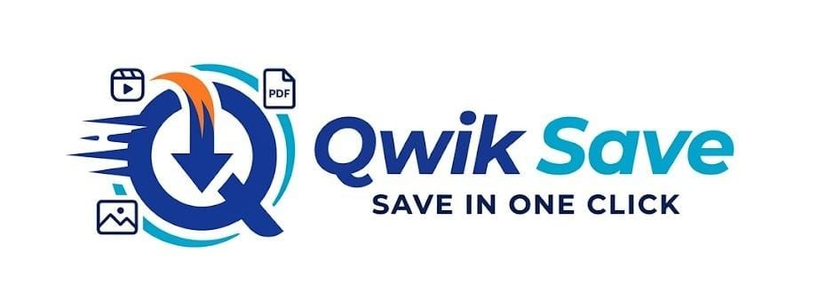
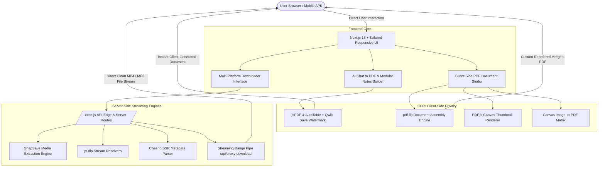

# Qwik Save — Save in One Click & Productivity Suite

<div align="center">



**Save in One Click** — An all-in-one high-performance web platform and mobile application combining enterprise AI-to-PDF conversion, multi-platform HD social media streaming downloads, and complete client-side PDF document manipulation.

[](LICENSE)
[](https://nextjs.org/)
[](https://www.typescriptlang.org/)
[](https://tailwindcss.com/)
[](https://college-study.netlify.app/)

</div>

---

## 👨‍💻 Project Developer & Attribution

- **Lead Architect & Developer:** **Priyal Kumar**
  - **LinkedIn:** [linkedin.com/in/priyal-kumar-780186291](https://www.linkedin.com/in/priyal-kumar-780186291/)
  - **Portfolio & Works:** [priyalkumar01.github.io](https://priyalkumar01.github.io/priyalkumar.github.io/)
- **Academic Platform Collaboration:** **[College Study](https://college-study.netlify.app/)** — Comprehensive semester study resources, notes, and technical tools.

---

## 🏛️ System Architecture



---

## 🚀 Key Feature Modules

### 1. 🤖 AI Chat to PDF & Academic Notes Builder
- **Direct Multi-LLM Parsing:** Converts public share links from ChatGPT (`chatgpt.com/share`), Claude (`claude.ai/share`), Google Gemini, and DeepSeek into structured, print-ready PDF documents.
- **Modular Notes Builder:** Build custom revision and exam question sheets topic-by-topic:
  - Formats **Questions / Topics** into highlighted cards with left accent markers.
  - Zero "User" or "Assistant" labels for pure academic styling.
  - Built-in formatting tools: **Bold** (`**text**`), *Italic* (`*text*`), and Bullet points (`• `).
- **Brand Watermark:** Every generated page includes a subtle, non-intrusive background watermark (~18% opacity) featuring **Qwik Save — Save in One Click**.
- **MS Word Shadow & Clean Border Frames:** Choose between classic academic drop-shadow border styles or minimalist single-line borders.

### 2. 📸 Instagram Downloader (Insta Save)
- Supports **Reels, Video Posts, Multi-photo Carousels, and Audio Tracks**.
- Extracts the uncompressed raw MP4 video stream directly from Instagram CDN with zero watermarks.
- Generates direct high-speed download links for both 1080p Full HD video and high-resolution cover photos.

### 3. 📘 Facebook Video & Reel Downloader
- Handles **Facebook Reels (`/reel/`), Watch videos (`/watch/`), and Mobile Share Links (`/share/v/`, `/share/r/`)**.
- Resolves HTTP 302 canonical URLs and extracts HD (720p/1080p) and SD (360p) streams.
- Performs instant HEAD requests to compute and display exact file size (e.g. `4.20 MB`, `2.15 MB`) on quality selection badges.

### 4. 🔴 YouTube Downloader
- Full support for **YouTube Shorts** and long videos (documentaries, lectures, podcasts).
- Provides instant MP4 video downloads and direct MP3 audio extraction.

### 5. 📑 Complete Client-Side PDF Tools Suite
- **Merge PDF with Top-to-Bottom Page Sequencing:**
  - Visual top-to-bottom stack displaying page-by-page previews of all uploaded documents.
  - Granular page actions: **Move Up**, **Move Down**, **Rotate 90° Clockwise**, and **Delete Page**.
  - Merges only the active pages in exact custom sequence.
- **Compress PDF:** Reduces file weight by 50% to 80% without noticeable degradation.
- **Image to PDF (JPG/PNG to PDF):** Merge, rotate, and convert multiple photos into an A4/Letter PDF.
- **PDF to Image:** Extract pages into high-resolution JPG or PNG graphics.

### 6. 🛠️ Utilities
- **Audio Extractor:** Decodes MP3/WAV audio directly from video files in your browser or from video URLs.
- **QR Code Studio:** Instant offline SVG and PNG QR code generator for URLs, WiFi credentials, and texts.

---

## 🔒 Privacy & Security Guarantee

1. **Client-Side Document Assembly:** PDF conversions and merges are processed entirely inside browser memory using Web Workers, HTML5 Canvas, and WebAssembly. No sensitive student notes or uploaded documents are ever sent to external servers.
2. **SSRF Guard:** Server-side fetchers validate URL destinations to protect against private IP traversal and internal network SSRF attempts.
3. **Zero Storage Policy:** Media proxy endpoints pipe chunked streams on-the-fly (`Transfer-Encoding: chunked`) without writing files to local disk.

---

## 🛠️ Tech Stack & Dependencies

| Layer | Technology |
|---|---|
| **Framework** | Next.js 16.4.6 (App Router + Turbopack) |
| **Language** | TypeScript 5.x |
| **Styling** | Tailwind CSS 3.4 with dark/light themes |
| **PDF Generation** | jsPDF, jsPDF-AutoTable, pdf-lib, PDF.js |
| **Media Extraction** | SnapSave Media Downloader, yt-dlp, Cheerio |
| **Icons & Typography** | Lucide React, Custom Brand SVG Icons |
| **Android App** | Android Native WebView with Kotlin & Android SDK 35/36 |

---

## 📦 Getting Started

### Prerequisites
- Node.js 18.x or newer
- Python 3.10+ (for yt-dlp binary bridge fallback)

### Installation
```bash
# Clone the repository
git clone https://github.com/priyalkumar01/GPTtoPDF.git
cd GPTtoPDF

# Install dependencies
npm install

# Run development server
npm run dev
```

Open [http://localhost:3000](http://localhost:3000) in your browser.

### Production Build
```bash
npm run build
npm start
```

---

## 📄 License

This project is licensed under the **MIT License** — see the [LICENSE](LICENSE) file for details.
