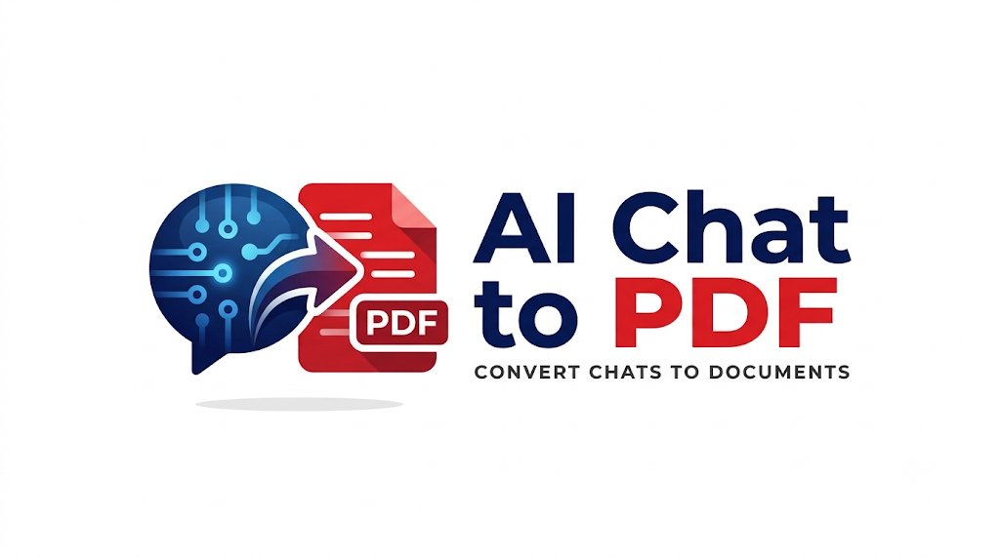
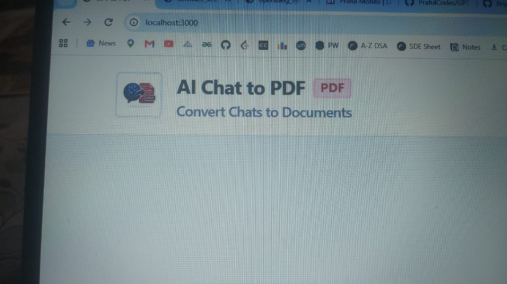
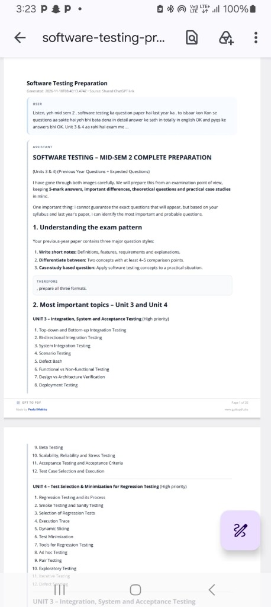
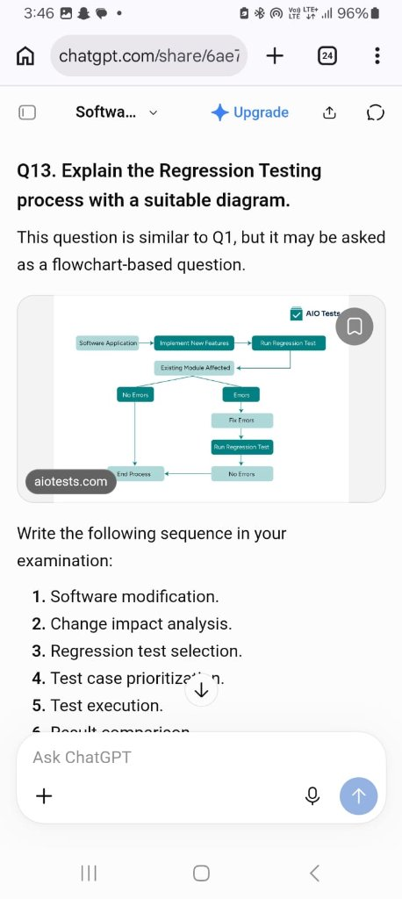

# AI Chat to PDF — Academic Document Converter

<div align="center">
  
  <p><strong>Universal, Frictionless Web App to Turn AI Conversations into Academic Study PDFs</strong></p>
  <p><em>No login • No sign-up • 100% Free Forever • Client-Side Privacy</em></p>
  <p>🚀 <strong>Live Website:</strong> <a href="https://www.ai-chat2pdf.live"><strong>https://www.ai-chat2pdf.live</strong></a></p>

  <p>
    <a href="https://nextjs.org"></a>
    <a href="https://www.typescriptlang.org"></a>
    <a href="https://tailwindcss.com"></a>
    <a href="https://github.com/parallax/jsPDF"></a>
    <a href="https://college-study.netlify.app/"></a>
    <a href="https://www.linkedin.com/in/priyal-kumar-singh/"></a>
  </p>
</div>

---

## 📖 Overview

**AI Chat to PDF** is a high-performance web application engineered specifically for university students, educators, and developers. During mid-semesters, end-semesters, and revision sessions, students use AI assistants (ChatGPT, Claude, Gemini, DeepSeek) to generate question papers, solutions, and notes. 

Raw browser screenshots or `Ctrl+P` result in messy chat bubbles, unsearchable text, or cut-off tables. **AI Chat to PDF** solves this by converting public shared chat links directly into **typeset, printable academic PDFs** with:
- High-resolution embedded diagrams & flowcharts
- MS Word Classic Drop-Shadow page borders
- Full inline message editing freedom before download
- Cute, responsive real-time loading feedback
- Permanent clickable attribution footers with author LinkedIn links

---

## 📸 User Interface & PDF Preview

<div align="center">
  <table>
    <tr>
      <td width="50%" align="center">
        <strong>Clean Desktop & Mobile UI</strong><br/><br/>
        
      </td>
      <td width="50%" align="center">
        <strong>Typeset Academic PDF with Diagrams</strong><br/><br/>
        
      </td>
    </tr>
    <tr>
      <td colspan="2" align="center">
        <strong>Preserved Visual Flowcharts & Testing Models</strong><br/><br/>
        
      </td>
    </tr>
  </table>
</div>

---

## ✨ Key Capabilities & Features

### 1. 🤖 Universal Multi-AI Platform Support
- **ChatGPT (OpenAI)**: `chatgpt.com/share/...` and `chat.openai.com/share/...` (Supports GPT-4o, o1-preview, Canvas, and GPT-3.5).
- **Claude (Anthropic)**: `claude.ai/share/...` (Supports Claude 3.5 Sonnet, Opus, and Haiku).
- **Google Gemini**: `gemini.google.com/share/...` (Supports Gemini 1.5 Pro and Flash).
- **Perplexity AI**: `perplexity.ai/search/...` (Extracts citations and structured answers).
- **Direct Text / Markdown Tab**: Instant paste for DeepSeek, Microsoft Copilot, Mistral, Llama, or raw notes.

### 2. ✏️ Live Document Preview & Inline Text Editing
- **Edit Anything**: Edit user prompts or assistant answers in an inline markdown textarea before generating the PDF.
- **Quick Clean AI Pleasantries**: One-click cleanup to strip AI filler phrases (*"Sure, here is..."*, *"If you like I want to explore this much in detail..."*).
- **Add Custom Notes**: Add custom question sets, formulas, or personal notes to the document.
- **Accurate Page Estimation**: Strips base64 image strings before counting characters, calculating true page counts (~28 pages for comprehensive 60k-character notes instead of inflated ~430 pages).

### 3. 🎨 Cute Professional Animated Loader
- When converting or extracting notes, a charming animated AI-to-PDF mascot appears with:
  - Bouncing document character with blinking eyes
  - Orbiting sparkle stars and shimmering gradient progress bar
  - Multi-stage real-time milestones: *Reading Share Link → Parsing Diagrams → Typesetting PDF*

### 4. 📄 MS Word Classic Shadow Border & Typography
- **Shadow Border**: Dual-layer frame with crisp primary border line and solid 1.0mm drop shadow on right and bottom edges.
- **Footer Margin Clearance**: Footer sits comfortably at `274.5mm` with a generous 5.5mm breathing room above the `290mm` bottom border line, completely eliminating any border overlap or line-cutting.
- **Font Scaling & Typography**: Switch between Modern Sans (Inter), Classic Academic Serif (Times), and Technical Monospace (Courier) in Compact (9pt), Standard (10pt), or Large (11.5pt) sizes.

### 5. 🎓 Partnered with College Study Hub
- Official promotion of **[College Study](https://college-study.netlify.app/)** — access free engineering semester notes, previous year question papers (PYQs), branch syllabus breakdowns, and exam preparation material.
- Header badge optionally displayed across all pages or strictly on the front cover.

### 6. 🔗 Permanent Clickable Brand Footer on Every Page
- **App Brand Lockup**: Official icon + **AI Chat to PDF** [PDF] linking to the website.
- **Developer Attribution**: **Developer: Priyal Kumar** linking directly to Priyal's LinkedIn profile.
- **Academic Pagination**: Clean page numbering (`Page 01 of 28`).

### 7. 🔒 100% Client-Side Privacy & Zero Login
- No account registration, email verification, passwords, or credit cards.
- Outbound link queries use strict Anti-SSRF guards.
- Final PDF is rendered inside browser memory using vector jsPDF; conversations are never stored in a database.

---

## 📁 Project Structure

```
GPTtoPDF/
├── app/
│   ├── api/extract/route.ts        # Secure backend API: SSRF protection & multi-AI parser
│   ├── faq/page.tsx                # 2-column wide FAQ knowledge base
│   ├── features/page.tsx           # Feature highlights & comparison table
│   ├── how-it-works/page.tsx       # 3-step student workflow guide
│   ├── privacy/page.tsx            # Zero-storage privacy & security architecture
│   ├── supported-platforms/page.tsx# Large official AI logos & College Study partnership
│   ├── globals.css                 # Structured slate backgrounds (#EEF2F6 & #090E17)
│   ├── layout.tsx                  # Root layout, theme sync, and SEO metadata
│   └── page.tsx                    # Clean converter home page
├── components/
│   ├── Navbar.tsx                  # Brand logo, animated hover underline, Developer link
│   ├── ConverterHero.tsx           # URL input, clipboard paste, sample notes, CuteLoader
│   ├── CuteLoader.tsx              # Bouncing document mascot & gradient progress bar
│   ├── ConversationPreview.tsx     # Full inline editor, customizer panel & PDF trigger
│   ├── CollegeStudyPromo.tsx       # College Study partnership promotion banner
│   └── Footer.tsx                  # Footer branding and Priyal Kumar LinkedIn link
├── lib/
│   ├── app-logo-b64.ts             # Embedded Base64 for app logo icon in PDF footer
│   ├── college-study-logo-b64.ts   # Embedded Base64 for College Study header logo
│   ├── config.ts                   # App URLs, developer LinkedIn, and default PDF options
│   ├── extract-ai.ts               # Universal multi-platform extractor & page estimator
│   ├── extract-chatgpt.ts          # Dedicated ChatGPT scraper and SSRF guard
│   ├── pdf-generator.ts            # jsPDF typesetting engine, shadow borders & footers
│   ├── sample-data.ts              # Pre-loaded exam revision sets
│   ├── theme-context.tsx           # Dark/light theme context provider
│   └── types.ts                    # TypeScript schema definitions
├── public/
│   └── images/                     # App icons, logos, and UI screenshot assets
├── scripts/
│   ├── test-diagram-in-pipeline.ts # Automated test for multi-page PDF generation
│   └── generate-commit-history.js  # Git commit history generator
├── package.json                    # Dependencies & Next.js scripts
└── tailwind.config.js              # Theme colors & 2px sharp square borders
```

---

## 🛠️ Local Development & Setup

### Prerequisites
- Node.js `v18.0.0` or higher
- npm / yarn / pnpm

### 1. Installation
```bash
git clone https://github.com/your-username/GPTtoPDF.git
cd GPTtoPDF
npm install
```

### 2. Run Local Development Server
```bash
npm run dev
```
Open [http://localhost:3000](http://localhost:3000) in your browser.

### 3. Run Production Build
```bash
npm run build
```

### 4. Verify PDF Generation via Test Script
```bash
npx tsx scripts/test-diagram-in-pipeline.ts
```

---

## 👨‍💻 Developer & Attribution

Developed with ❤️ for students preparing for exams by:

**Priyal Kumar Singh**  
- **LinkedIn**: [linkedin.com/in/priyal-kumar-singh/](https://www.linkedin.com/in/priyal-kumar-singh/)  
- **Email**: `230104043@hbtu.ac.in`  
- **Academic Partner**: [College Study Hub](https://college-study.netlify.app/)

---

## 📜 License
This project is open-source and free for all students and educators under the [MIT License](LICENSE).
